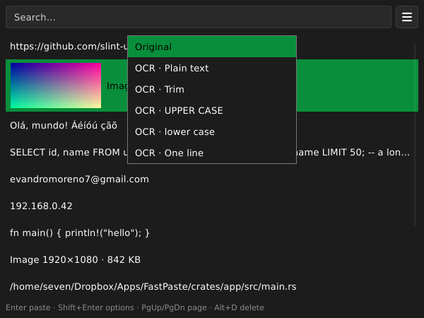

# FastPaste

[](https://github.com/evandro777/FastPaste/actions/workflows/ci.yml)
[](https://github.com/evandro777/FastPaste/actions/workflows/flatpak.yml)
[](https://github.com/evandro777/FastPaste/actions/workflows/appimage.yml)
[](https://github.com/evandro777/FastPaste/actions/workflows/virustotal.yml)
[](https://www.linux.org/)
[](https://opensource.org/licenses/GPL-3.0)

A tiny clipboard history for Linux (X11), inspired by CopyQ. Written in Rust with [Slint](https://slint.dev), software renderer, no GL. It runs in the background, remembers what you copy (text, HTML and images) and brings it back with a global shortcut. **Light and fast**: the goal is a quick start and little memory.

Landing page: <https://evandro777.github.io/FastPaste/>



## Features

- History of text, HTML and **images** (PNG or JPEG, stored as PNG, up to 8 MB; a JPEG over 8 megapixels is skipped), deduplicated, up to 500 entries; search as you type (all words must match, case-insensitive)
- Size limits: all text together is capped at 32 MiB and all images together at 1 GiB, and the oldest entries go first. A copy skipped for size is reported on stderr
- Images show as a thumbnail with their size; Enter pastes the original PNG. Plain text and the other menu transforms paste text only (they do not change the stored entry)
- Keyboard first: run it once and press **Ctrl+Alt+V**; `Shift+Enter` (or right click) opens the options menu for plain text, text transforms and OCR
- Opens centered on the mouse pointer (kept inside that monitor), remembers the size you give it, and closes when it loses focus
- Pastes back into the window you were using with Ctrl+V (Ctrl+Shift+V in terminals). If that window cannot be refocused, nothing is sent and the entry stays on the clipboard
- Copies from password managers (the `x-kde-passwordManagerHint` flag, set by KeePassXC, Bitwarden and others) are never recorded
- Tray icon (**Open**, **Preferences…**, **Quit**) and start at login; the **☰** button next to the search box opens the preferences too
- Interface in English and Português (Brasil); follows the system locale

| Key                   | Action                                                              |
|-----------------------|---------------------------------------------------------------------|
| type                  | search                                                              |
| Up / Down             | move the selection                                                  |
| Enter                 | paste the selection, keeping its formatting                         |
| Shift+Enter           | options menu (Up/Down, Enter, Esc)                                  |
| PgUp / PgDn           | move one page of rows at a time                                     |
| ↓ / scroll to the end | the list shows 20 entries and loads the next 20 on reaching the end |
| Right click           | the Shift+Enter options menu for the row under the pointer          |
| Alt+D                 | delete the entry                                                    |
| Esc                   | close                                                               |

## Status

Early pilot. Works on **X11** (tested on Cinnamon). There is no Wayland support: it does not allow a global shortcut or watching the clipboard from a background app.

The tray icon needs a StatusNotifier host (Cinnamon, KDE and GNOME with the AppIndicator extension have one). Without one the app prints a message and keeps working, only without the icon.

## Install

### OCR: Tesseract (optional)

To extract text from an image, install `tesseract`. Example of a Debian/Ubuntu command line to install English and Portuguese:

```bash
sudo apt install tesseract-ocr tesseract-ocr-eng tesseract-ocr-por
```

More information in [BUILD.md](BUILD.md#text-from-an-image-ocr).

### Flatpak

#### Install from file (no updates)

Download `FastPaste-<version>-x86_64.flatpak` from [Releases](https://github.com/evandro777/FastPaste/releases), then execute:

```bash
flatpak install --user ~/Downloads/FastPaste-<version>-x86_64.flatpak
```

Installing from file, will not auto update.

#### Install with automatic updates

Every release is also published as a Flatpak remote, so `flatpak update` (or your software centre) keeps FastPaste current. A `.flatpak` file downloaded from Releases is a one-off install: to get updates, add the remote below.

```bash
flatpak remote-add --system --if-not-exists fastpaste https://evandro777.github.io/FastPaste/fastpaste.flatpakrepo
flatpak install --system fastpaste io.github.evandro777.FastPaste
```

**`--system` vs `--user` matters for updates.** Linux Mint's Update Manager (and probably other software centres) only looks at *system-wide* Flatpaks; a `--user` install never appears there. With `--user`, update by hand: `flatpak update --user` (a plain `flatpak update` only checks the system installation).

The remote is GPG-signed (system-wide installs refuse unsigned remotes), but the key lives in this same repository, so it is only as trustworthy as the repository it is built from. It needs the Flathub remote for the runtime (`flatpak remote-add --if-not-exists flathub https://dl.flathub.org/repo/flathub.flatpakrepo`, with `--system` or `--user` to match).

For a desktop shortcut use the command `flatpak run io.github.evandro777.FastPaste --toggle`.

- **Start at login** asks the desktop through the Background portal; if you refuse, reset it with `flatpak permission-reset io.github.evandro777.FastPaste`. The portal writes a bare entry (the app id as its name, no icon, no description). To get a complete one, optionally let FastPaste write its own entry in your autostart folder (FastPaste uses it automatically when it is there; switch **Start at login** off and on once afterwards):

    ```bash
    flatpak override --user --filesystem=xdg-config/autostart io.github.evandro777.FastPaste
    ```

    - It only opens `~/.config/autostart`, nothing else. Undo it with `flatpak override --user --reset io.github.evandro777.FastPaste`.

- **OCR** needs the host's `tesseract`, which the sandbox cannot see. It is off unless you grant it yourself, on your own account (until then the OCR menu entries are dimmed, and the preferences show this command):

    ```bash
    flatpak override --user --talk-name=org.freedesktop.Flatpak io.github.evandro777.FastPaste
    ```

- FastPaste runs the host's `tesseract` through `flatpak-spawn --host`. This lets it start commands outside the sandbox, which removes most of what the sandbox protects, so it is your choice. Undo it with `flatpak override --user --reset io.github.evandro777.FastPaste`.

- The Flatpak keeps its data in `~/.var/app/io.github.evandro777.FastPaste/`, separate from the AppImage's. Run one of the two, not both: the second one cannot take the shortcut.

### AppImage (with delta updates)

Download `FastPaste-<version>-x86_64.AppImage` from [Releases](https://github.com/evandro777/FastPaste/releases), then execute:

```bash
sudo chmod +x ~/Downloads/FastPaste-<version>-x86_64.AppImage
~/Downloads/FastPaste-<version>-x86_64.AppImage
```

It uses the fontconfig, xkbcommon and X11 libraries already on your system.

For a keyboard shortcut use the command `/path/to/FastPaste-<version>-x86_64.AppImage --toggle` (it must point at the file, so keep it in a fixed place).

The AppImage does not update itself, but it has update information built in, so a tool such as [AppImageUpdate](https://github.com/AppImageCommunity/AppImageUpdate) (`appimageupdatetool FastPaste-*.AppImage`), [Gear Lever](https://github.com/mijorus/gearlever) or [AppManager](https://github.com/kem-a/AppManager) downloads only the changed parts of the next release.

## Build & Configurations

[Build and configurations information](BUILD.md): building from source, the Flatpak and AppImage builds, the settings file, OCR and using your desktop's own shortcut. To see what the app decides (open, focus, paste), run `FASTPASTE_DEBUG=1 fastpaste`.

## Contributing and releases

See [`CONTRIBUTING.md`](CONTRIBUTING.md) to build, test and send a change, and [`RELEASING.md`](RELEASING.md) for how a release is cut. CI (format, clippy, tests, `cargo audit` against the RustSec advisories, MSRV, packaging checks, and the AppImage and Flatpak builds) runs on every pull request.

## License

GPL-3.0-or-later. See [`LICENSE`](LICENSE).
